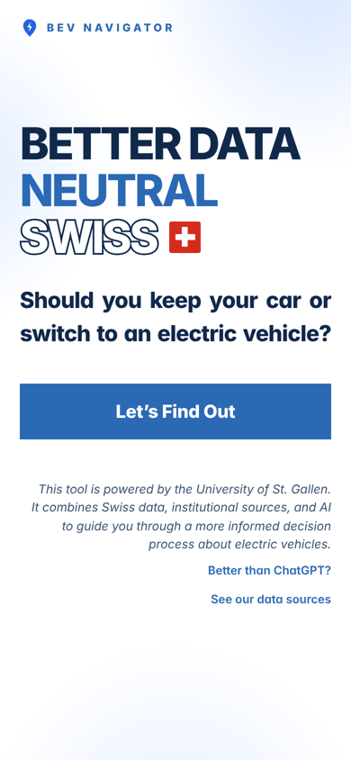
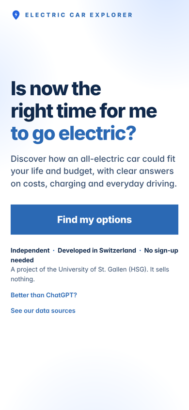
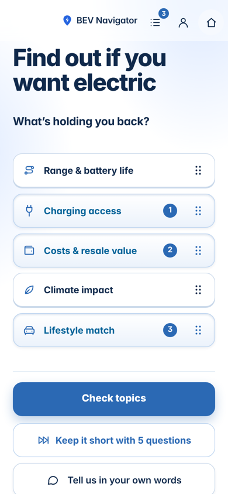
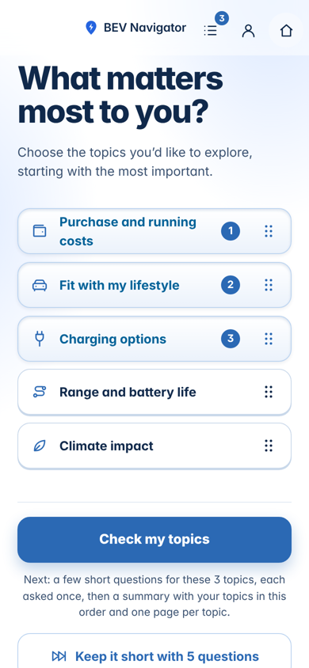
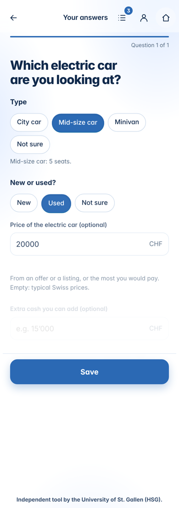
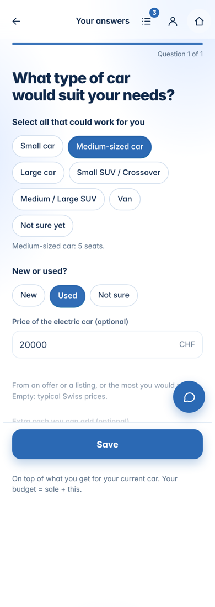
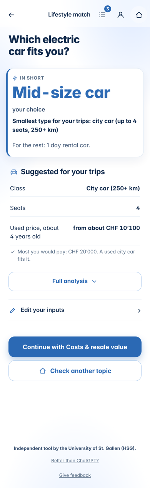
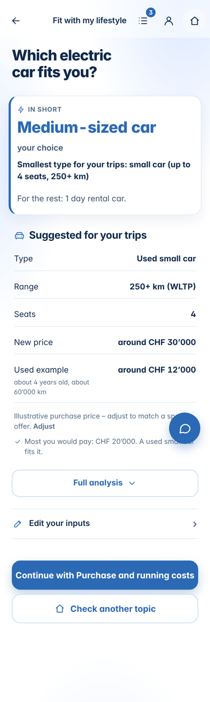
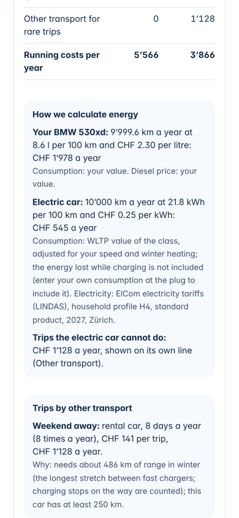
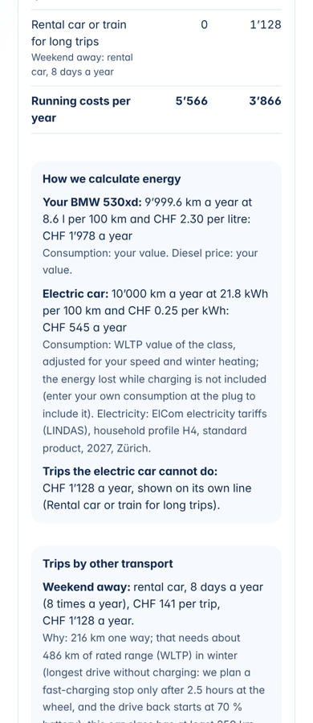

# BEV Navigator – audit dei feedback e preview verificabile (26.11.2026)

## 0. Dove guardare

| | |
|---|---|
| **Preview** | https://bev-navigator.zurich-hsg.workers.dev/preview/ |
| **Build** | commit `7852424` su `main` (solo `public/preview/` e `ui-loop/`). Le modifiche sono nei commit `5359cd6`, `ab9dc71`, `0588e24` e `7852424`. |
| **Backend dei calcoli** | n8n `T –` (copia di test, webhook `/navigator-test`). |
| **Chat, AI summary, feedback** | Usano gli stessi webhook della release: `/assist-claude`, `/summary`, `/feedback`. Non li ho modificati, quindi non è servita una copia dedicata. Attenzione: un feedback inviato dalla preview finisce nella stessa tabella `ui_feedback` della release. |
| **Release e demo principale** | Non toccate. Prima e dopo il deploy gli hash coincidono: `/release/2026-11-25/index.html` = `b0f33329…` e `/index.html` = `505d8cf4…`. |
| **Storage** | Separato da quello della demo (`bevnav.preview.v1`). |

**Percorsi rapidi**

| Cosa vedere | Come |
|---|---|
| Start (slide 3) | `/preview/` |
| Scelta dei temi (slide 4) | `/preview/` → **Find my options**. Tocca i temi nell'ordine voluto: il primo toccato diventa 1. |
| Lifestyle fit (slide 5) | Icona lista in alto a destra (**Your answers**) → **Electric car**, oppure il percorso con il tema **Fit with my lifestyle** |
| Caso BMW–Mégane, input del Word | `/preview/?example=bmw-megane` (apre Costs: CHF 5'000 di cassa, 41'090 contro 29'950, CHF 11'140) |
| Stesse auto con i dati dell'app | `/preview/?example=bmw-megane-app` |
| Caso slide 6–8 (noleggio, mismatch) | `/preview/?example=weekend-lugano`, poi Summary → **Purchase and running costs**. Per provare il mismatch: in Costs tocca **New** (what-if), poi torna alla Summary. |
| Test automatici | `ui-loop/tools/feedback_audit.js` (locale, 29 controlli). Per i test dal vivo, nella console della preview: `const m = await import('/preview/stress.js'); await m.run('S1')`. |

---

## 1. Modifiche da guardare (prima → dopo)

Gli screenshot sono a 390 px, con dati sintetici e risposte n8n salvate. Si trovano in `ui-loop/audit_2026-11-26/`.

### 1.1 Start – slide 3 (N-03)
| Prima | Dopo |
|---|---|
|  |  |

- **Prima.** Claim "Better data / Neutral / Swiss", domanda "Should you keep your car or switch…", bottone "Let's Find Out", testo HSG lungo.
- **Dopo.** Ordine proposto da Christian:
  1. lo scopo per l'utente: **"Is now the right time for me to go electric?"** + il sottotitolo di Christian, parola per parola;
  2. il bottone **Find my options**;
  3. la riga di fiducia piccola e sotto: **Independent · Developed in Switzerland · No sign‑up needed**, più "A project of the University of St. Gallen (HSG). It sells nothing.";
  4. i link "Better than ChatGPT?" e "See our data sources".
- **Nome.** Il marchio in alto è **ELECTRIC CAR EXPLORER**, visibile in preview. Il cambio di nome resta una **decisione per Simone** (D3): barra in alto, PDF e titolo della pagina dicono ancora "BEV Navigator".
- **"No personal data stored" non è usato.** Oggi non è vero:
  - n8n salva ogni esecuzione con il profilo completo (CAP, viaggi, auto, prezzo di vendita) e con l'IP e lo user-agent del visitatore (esecuzione `T – API Navigator` 21340, nodo Webhook);
  - il login facoltativo salva i dati in Supabase;
  - la chat passa il testo a OpenAI;
  - il feedback viene salvato.

  Al suo posto c'è "No sign‑up needed", che è vero. Le opzioni per rendere vera la frase sono in D2.
- **Desktop:** `audit_2026-11-26/after_1280_1_landing.png`.

### 1.2 Scelta dei temi – slide 4 (N-04)
| Prima: toccati Costs → Lifestyle → Charging | Dopo: stessa sequenza |
|---|---|
|  |  |

- **Testo.** Titolo **What matters most to you?**, sottotitolo "Choose the topics you'd like to explore, starting with the most important." Prima c'erano "Find out if you want electric" e "What's holding you back?".
- **Etichette e ordine di Christian:**
  1. Fit with my lifestyle;
  2. Purchase and running costs;
  3. Charging options;
  4. Range and battery life;
  5. Climate impact.

  Le stesse etichette compaiono nei titoli dei risultati, nella Summary e nel PDF.
- **Interpretato male prima: la priorità.** La priorità seguiva la posizione nella lista, non l'ordine dei tocchi. Nello screenshot "prima", Costs toccato per primo risultava 2 e Charging 1. Ora il primo tema toccato è 1 e sale in cima; il drag e Alt + frecce funzionano ancora. Se togli un tema, gli altri si rinumerano.
- **Cosa succede premendo il bottone.** **Check my topics** ha sotto una riga che lo spiega: "Next: a few short questions for these 3 topics, each asked once, then a summary with your topics in this order and one page per topic."
- **Ordine reale del percorso, verificato dal vivo.**
  - Le domande di tutti i temi scelti si fanno una volta sola, poi c'è la Summary. Non si va tema per tema.
  - Se Costs è prima di Lifestyle, il codice anticipa comunque Lifestyle ("prima l'auto, poi i suoi costi").
  - Ora la Summary mantiene l'ordine scelto dall'utente (`store.priority`).
  - Se tenere l'anticipo di Lifestyle è una decisione (D7).

### 1.3 Lifestyle fit – slide 5 (N-05)
| Prima: domanda | Dopo: domanda |
|---|---|
|  |  |

- **Domanda.** **What type of car would suit your needs?** con "Select all that could work for you".
- **Categorie di Christian, a scelta multipla:**
  - Small car
  - Medium-sized car
  - Large car
  - Small SUV / Crossover
  - Medium / Large SUV
  - Van
  - Not sure yet (azzera le altre)
- **Limite dei dati.** In `vehicle_classes` le classi sono solo tre taglie (S / M / L), senza tipo di carrozzeria. Ogni categoria corrisponde quindi a una taglia:

  | Categorie | Taglia |
  |---|---|
  | Small car, Small SUV / Crossover | S |
  | Medium-sized car, Medium / Large SUV | M |
  | Large car, Van | L |

- **Regola con più categorie.** Si calcola con la taglia più piccola tra quelle scelte (la più economica che potrebbe andare), e la schermata lo dice. Se posti o viaggi chiedono un'auto più grande, Fit with my lifestyle lo spiega. Le altre taglie si confrontano in Costs. Vedi D4 e D6.
- **Risultato** (verificato dal vivo con `?example=weekend-lugano`). Il titolo è il nome della categoria scelta ("Medium / Large SUV"). Sotto:

  | Riga | Valore |
  |---|---|
  | Type | Used medium or large SUV |
  | New price | around CHF 39'000 (centro della fascia della classe) |
  | Used example | around CHF 16'000, about 4 years old, about 60'000 km |
  | Your price | CHF 20'000 |

  Poi "Illustrative purchase price – adjust to match a specific offer. **Adjust**".
- **Prezzo usato d'esempio.** Viene dalla stessa curva BFE/EBP usata in Costs (circa 4 anni). I 60'000 km sono la nostra ipotesi di 15'000 km l'anno: non entrano nel prezzo.
- **Il nome segue in tutto il percorso.** La stessa categoria compare in Costs (chip "Medium / Large SUV…"), nella riga Summary "Electric car you are looking at: Medium / Large SUV, used, about CHF 20'000" e nel PDF (test N-05e/h/i). I prezzi della slide (40'000 / 23'000) restano solo un esempio: l'app mostra i suoi.

| Prima: risultato (fixture) | Dopo: risultato (fixture) |
|---|---|
|  |  |

### 1.4 Risultati che non coincidono – slide 6–7 (N-06)
**Origine.** Gli screenshot di Christian ("Start My Journey") vengono dalla demo principale prima del 25.11 alle 20:24 (frontend precedente).

**Riproduzione sulla preview prima della correzione** (fixture `christian_mu`: BMW venduta a CHF 15'000, Medium used CHF 20'000, 6 anni):

| | Costs, dopo un tocco su "New" | Summary / verdetto | PDF |
|---|---|---|---|
| Atteso | what-if: nuova, cassa 23'960 | la scelta salvata: usata, cassa 5'000, CHF 13'990 in meno | come Summary |
| Ottenuto prima | nuova, −1'030 | **nuova, −1'030, "you pay 24'000 upfront"**, mentre la pagina diceva "Summary and PDF keep your choice (used, 20'000)" | nuova |
| Ottenuto ora (dal vivo, `weekend-lugano`) | nuova, −16'020, cassa 24'960, con il riquadro "What-if" | **usata, −840, cassa 6'000** | cassa 6'000 |

- **Causa.** `b3Pick` leggeva le scelte della pagina Costs (taglia, nuova/usata, prezzo del diesel) ovunque: Summary, verdetto, fatti per l'AI, PDF, CSV. È lo stesso tipo di incoerenza delle slide 6–7: Costs "3'800 less" contro Summary "4'400 more, 14'000 upfront".
- **Correzione.** Le scelte what-if valgono solo mentre si disegna la pagina Costs (`B3_PAGE`). Il resto usa la scelta salvata.
- **Test:** N-06a/b/c (locale); S6 nuovi controlli "verdict keeps the saved car" e "PDF keeps the saved car" (dal vivo, 390 e 1366: 7/7).

### 1.5 "Other transport" – slide 8 (N-08)
| Prima | Dopo |
|---|---|
|  |  |

**Origine** (dal vivo, `weekend-lugano`). È il noleggio per i viaggi che la classe scelta non fa: "Weekend away" Zurigo → Lugano, 216 km di sola andata (2,4 h), 8 volte l'anno. Costa un'auto a noleggio per 8 giorni a CHF 141 l'uno, cioè **CHF 1'128 l'anno** (6'768 in 6 anni). Da solo fa passare l'EV da conveniente a "−840".

**Perché il noleggio.**
- Il modulo Trips programma una sosta di ricarica solo dopo **2,5 ore** di guida.
- Il viaggio di 2,4 h va quindi fatto con una carica. Il ritorno parte con il 70 % utile della batteria: 216 / 0,7 = 309 km reali, cioè 486 km WLTP in inverno.
- La classe ha 250 km WLTP.
- È la stessa logica criticata da Martin il 16.11 (nonni a 150 km) e da Christian nell'email del 16.11 ("battery range and need for renting another car").

**Correzioni UI.**
- La voce si chiama **"Rental car or train for long trips"** e sotto la riga c'è il viaggio che la genera ("Weekend away: rental car, 8 days a year").
- La legenda delle barre dice "Rental car / train".
- **Interpretato male prima: la spiegazione.** Diceva "the longest stretch between fast chargers; charging stops on the way are counted" anche quando nessuna sosta era prevista. Ora dice: "216 km one way; that needs about 486 km of rated range (WLTP) in winter (longest drive without charging: we plan a fast-charging stop only after 2.5 hours at the wheel, and the drive back starts at 70 % battery); this car class has at least 250 km."

**Non cambiato.** La regola di calcolo in n8n cambierebbe i risultati del concept: è la decisione D1.

---

## 2. Pipeline riutilizzabile

**ID stabili per fonte:**

| Prefisso | Fonte |
|---|---|
| `N-` | Christian, slide 25.11 |
| `F-` | Meeting 9.11 |
| `E-` | Email di Christian del 16.11 |
| `M-` | Martin 16.11 |
| `P-` | Philipp e Sascha, `11. word` / `Teams/UI/Feedbacks.docx` |
| `A-` | AI, Philipp |
| `H-` | PDF di Philip |
| `W-` | Meeting 20.11 |
| `K-` | Switch Compass e ricerca comportamentale |
| `S-` | Note di Simone ("navigazione poco intuitiva") |
| `T-` / `A1…` / `S1` | 8.11 (Theo, Alberto, Sascha) |
| `C-` / `M0x` | Iterazione 24.11 |
| `R-` | Review ChatGPT 001–003 |

- **Richieste uguali** hanno un solo ID, con tutti i riferimenti nella colonna Fonte.
- **Campi** (§3): fonte · interpretazione (richiesta concreta + schermata) · criterio di accettazione · comportamento osservato prima · stato · modifica ed evidenza · **R/C/F**.
- **R/C/F:**
  - **R** = recepito (è arrivato nel lavoro);
  - **C** = capito (implementato nel senso inteso);
  - **F** = funziona oggi.
  - Valori: ✓ / ~ / ✗ / – (non applicabile).
- **Stati:**
  - ✅ già corretto
  - 🟡 parziale
  - ⚠️ interpretato male (corretto o da decidere)
  - ⛔ mancante
  - ⏭ superato
  - ❓ da decidere
- **Livelli di evidenza:**
  - **LIVE** = browser sulla preview con n8n `T –`;
  - **FIX** = browser locale con risposte n8n salvate;
  - **N8N** = esecuzione o codice n8n letto;
  - **CODE** = solo lettura del codice. Vale come indizio, non come prova: lo dico dove succede.
- **Ripetere al prossimo giro:**
  1. `node ui-loop/tools/feedback_audit.js` (30 controlli: N-03, N-04, N-05, N-06, N-08 con il caso Christian);
  2. `stress.js` S1–S14 nella preview (390 e 1366);
  3. per i nuovi feedback, aggiungere ID e righe in questa tabella.

---

## 3. Registro completo

### 3.1 Nuovo feedback di Christian (pptx 25.11, cartella 22.11)

| ID | Fonte | Interpretazione (cosa, dove) | Criterio di accettazione | Prima (osservato) | Stato | Modifica / evidenza | R/C/F |
|---|---|---|---|---|---|---|---|
| N-01 | Slide 2 ("Summary") | Riepilogo di N-03, N-04, N-05: nuove parole per Start e primo schermo, nuovi nomi delle categorie | vedi N-03, N-04, N-05 | – | ✅ | vedi sotto | ✓/✓/✓ |
| N-02 | Slide 1 (titolo "Feedback – Electric Car Explorer", con la sua start) | Nome del prodotto "Electric Car Explorer" | Nome visibile in preview, decisione separata | Marchio "BEV NAVIGATOR" | ❓ | Marchio della Start in preview. Barra, PDF e titolo restano "BEV Navigator" → **D3** | ✓/✓/~ |
| N-03 | Slide 3 | Start dal punto di vista dell'utente: scopo prima ("60 % potential" = chi è aperto ma non ha deciso, transcript 20.11 [01:03] e [50:55]); claim di fiducia più piccolo e sotto; testo e bottone di Christian | Domanda + sottotitolo sopra il bottone; fiducia sotto, in piccolo; bottone "Find my options"; nessuna frase non vera | Claim "Better data / Neutral / Swiss", "Let's Find Out" | ✅ (claim privacy ❓) | §1.1. FIX: N-03a–g a 390 e 1280 (N-03g: le righe della domanda non vengono tagliate; trovato e corretto un taglio a ~600 px). LIVE: start visibile, nessun overflow a 1366. Privacy → **D2** | ✓/✓/✓ |
| N-04 | Slide 4 (testo ripetuto nelle slide 6–7) | Titolo, istruzione, 5 etichette, "Check my topics"; partire dal tema più importante; capire cosa succede | Primo tocco = 1; etichette uguali alla slide; riga "Next:" vera; ordine del percorso documentato | "Find out if you want electric", priorità = posizione | ✅ | §1.2. FIX N-04a–g (390/1280). LIVE: priorità e riga "Next" su `/preview/`; coda reale `B4, B3` con Costs toccato prima → **D7** | ✓/✓/✓ |
| N-05 | Slide 5 | 7 categorie, scelta multipla, nome della categoria nel risultato; Used medium + prezzo coerenti fino a Costs, Summary, PDF; prezzi della slide solo esempio | Più categorie salvate; il risultato le nomina; "Used example" + "Illustrative…"; stessa auto in Summary e PDF | 3 tipi a scelta singola (City car / Mid-size / Minivan) | ✅ con limite dati ❓ | §1.3. FIX N-05a–i. LIVE `weekend-lugano`: "Medium / Large SUV", Used example, Your price, Summary. Limite: 3 taglie → **D4**, **D6** | ✓/✓/✓ |
| N-06 | Slide 6–7 | Summary e Costs danno risultati diversi per la stessa auto | Con la scelta salvata Costs = Summary = PDF; con un what-if su Costs, Summary e PDF restano sulla scelta salvata | Il what-if passava in Summary e PDF (riprodotto, §1.4) | ⚠️ → ✅ | Correzione `B3_PAGE`. LIVE S6 7/7 (390 e 1366); LIVE `weekend-lugano`: Costs −16'020 (what-if) / Summary −840 / PDF cassa 6'000 | ✓/✗→✓/✓ |
| N-08 | Slide 8 | "What is the position Other transport?" | Nome chiaro, viaggio e importo visibili nella riga, spiegazione vera | "Other transport for rare trips", spiegazione "stops counted" sbagliata per viaggi < 2,5 h | ⚠️ testo → ✅; regola ❓ | §1.5. FIX N-08a–d. LIVE `weekend-lugano`: riga "Weekend away: rental car, 8 days a year", CHF 1'128/anno. Regola → **D1** | ✓/~/✓ |

### 3.2 Christian e Daniel – meeting del 9.11 (`09.11/Meeting's notes.docx`)
| ID | Richiesta | Criterio | Stato | Evidenza / nota | R/C/F |
|---|---|---|---|---|---|
| F-01 | "Say for how many years I want it and then have cost per year" | Anni scelti → costo l'anno | ✅ | LIVE S1: anni 1–12, "about CHF … a year", orizzonte salvato | ✓/✓/✓ |
| F-02 | Messaggio troppo generico ("what factors make you hesitant") | Domanda chiara | ⏭ | Sostituito da N-04 ("What matters most to you?") | ✓/✓/✓ |
| F-03 | Wording troppo breve (es. "charging" = accesso alla ricarica) | Etichette che dicono di cosa si tratta | ✅ | Etichette di Christian del 25.11 (N-04) | ✓/✓/✓ |
| F-04 | Upfront cost e running cost sono preoccupazioni diverse | Blocchi separati | ✅ | LIVE S1: Upfront / Running / Depreciation | ✓/✓/✓ |
| F-05 | Resale value: si ripaga? | Payback esplicito | ✅ | LIVE S1/S3: "Pays off in year N" / "Does not pay off within N years" | ✓/✓/✓ |
| F-06 | **"Don't forget multiple choice: drag and drop, priority listing"** | Più temi; priorità = ordine scelto dall'utente | ⚠️ → ✅ | Scelta multipla e drag c'erano, ma un tocco non dava priorità (contava la posizione). Ora il tocco dà priorità (N-04c). FIX + LIVE | ✓/~→✓/✓ |
| F-07 | **"Give early summary pretty fast and deep dive possible later"** | Summary dopo un solo giro di domande; dettagli per tema | ✅ | LIVE: un giro di domande → Summary; "In short" + "Full analysis" | ✓/✓/✓ |
| F-08 | Combinare viaggi singoli invece di set predefiniti | Viaggi singoli | ✅ | I set ("City, car-light" …) sono solo scorciatoie; "define my own trips" c'è (CODE + FIX regress) | ✓/✓/✓ |
| F-09 | **Budget!!** | Budget nel calcolo | ✅ | LIVE S4: prezzo EV + "Extra cash you can add", limite spiegato | ✓/✓/✓ |
| F-10 | **Fiducia**: migliori fonti svizzere, "developed by HSG with partners" | Visibile presto | 🟡 | Riga HSG + fonti sulla Start (N-03); partner e istituzioni non ci sono (→ W-01) | ✓/✓/~ |
| F-11 | Scelta della lingua (Daniel) | DE/FR/IT | ⛔ | Solo inglese. Fuori dall'iterazione | ✓/–/✗ |
| F-12 | Immagini (Daniel) / icone (Christian) | Icone | ✅ | Icone in temi e risultati. Contraddizione risolta a favore di Christian (chat del 16.11: "Icons yes pictures no") | ✓/✓/✓ |
| F-13 | Troppo complesso rispetto a ChatGPT (Daniel) | Risposta rapida + perché fidarsi | 🟡 | "Keep it short with 5 questions", Summary, "Better than ChatGPT?" | ✓/✓/~ |

### 3.3 Email di Christian del 16.11 e Martin (16.11, `11. word.docx`)
| ID | Fonte | Richiesta | Stato | Evidenza / nota | R/C/F |
|---|---|---|---|---|---|
| E-01 | Email 16.11 (articolo Tages-Anzeiger) | "Easy clicking and straight forward results" | 🟡 | Switch rapidi in Costs (taglia, anni, ±30 % diesel, mappa CHF 50). Le classi del Tagi (Kleinwagen…Premium) sono superate dalle categorie della slide 5 | ✓/✓/~ |
| E-02 | Email 16.11 | Ipotesi su autonomia e noleggio di un'altra auto | 🟡 ❓ | Ora spiegato (N-08). La regola delle 2,5 h genera ancora noleggi su viaggi di 150–250 km → **D1** | ✓/~/~ |
| E-03 | Email 16.11 | Costi una tantum mescolati ai costi di gestione | ✅ | LIVE S1, blocchi separati | ✓/✓/✓ |
| E-04 | Email 16.11 | La city car non si ripaga in nessuno scenario | ✅ | Dipende dal profilo: LIVE S3 dà payback 12 / nessuno / 2 / 9 a seconda di classe e usato. Il caso Lugano mostra che il risultato negativo viene dal noleggio (D1) | ✓/✓/✓ |
| M-01 | Martin 16.11 | Noleggio per ogni visita ai nonni a 150 km; "add one charging stop … or let the user choose" | ⚠️ ❓ | Il 25.11 è stato aggiunto il "why", ma per i viaggi < 2,5 h la sosta non è mai prevista e il testo diceva "stops counted". Testo corretto; regola → **D1** | ✓/~/~ |
| M-02 | Martin 16.11 | Pagina dei risultati troppo piena | ✅ | "In short" + "Full analysis" (LIVE) | ✓/✓/✓ |
| M-03 | Martin 16.11 | Spazi mancanti ("aboutCHF 11,000more") | ✅ | LIVE: "about CHF 140 a year", "CHF 13'990 less" | ✓/✓/✓ |
| M-04 | Martin 16.11 | "Your choice" confuso se non hai scelto nulla | ✅ | "Your choice" solo se l'auto è la tua scelta, altrimenti "Suggested for your trips" (FIX N-05) | ✓/✓/✓ |
| M-05 | Martin 16.11 | 8000 → "4-digit Swiss postal code" confonde | ✅ (CODE) | Testo "Postcode not found – try e.g. 8001". Non ritestato nel browser | ✓/✓/~ |
| M-06 | Martin 16.11 | Contatore che salta ("3 of 4" → "4 of 5") | 🟡 (CODE) | Il conteggio include i dettagli dell'auto finché non è nota. Il totale può ancora crescere se una risposta apre domande nuove. Non riprodotto passo per passo: test manuale proposto | ✓/~/? |

### 3.4 Philipp e Sascha (`11. word.docx`, `Teams/UI/Feedbacks.docx`, PDF di Philip del 15.11)
| ID | Richiesta | Stato | Evidenza / nota | R/C/F |
|---|---|---|---|---|
| P-01 | In alto a destra cosa hai già compilato | ✅ | Icona lista con badge → "Your answers" (LIVE) | ✓/✓/✓ |
| P-02 | Link a ogni fonte | ✅ | Pillole "Source ↗" (LIVE in Costs; 25.11: 0 senza link in B1/B2/B7) | ✓/✓/✓ |
| P-03 | "Our assumption" distinto da una fonte | ✅ | "Our assumption" / "Your value" / fonte (LIVE) | ✓/✓/✓ |
| P-04 | Fonti in fondo | ✅ | "Assumptions & sources" chiuso in fondo | ✓/✓/✓ |
| P-05 | Tooltip per i termini (WLTP, kWh…) | ✅ (CODE + FIX) | Glossario cliccabile (`gloss`) | ✓/✓/✓ |
| P-06 | Ordine del risultato: ipotesi in fondo, "change your data" in alto | 🟡 | Ipotesi in fondo; "Edit your inputs" sta sotto l'"In short", non in cima | ✓/~/✓ |
| P-07 | Togliere "Battery" da "Battery & resale", batteria sotto Range, "Resale value" | 🟡 ❓ | Batteria sotto "Range and battery life" ✓. L'etichetta Costs di Christian (25.11) non nomina più "resale" → **D5** | ✓/✓/~ |
| P-08 | Frase di B1 troppo complicata ("about166 km") | ✅ | LIVE: "Range needed: 309 km", "Your trips need about 309 km of real range on 90 % of your driving days" | ✓/✓/✓ |
| P-09 | Grafico di B1 non capito (Philipp, Christian) | 🟡 | Grafico ancora presente in "Full analysis", con tooltip; nessun nuovo feedback su questo. Da ricontrollare con Christian | ✓/~/? |
| P-10 | Weiherstrasse 2 → la mappa mostrava Landquart invece di Wetzikon | ✅ | LIVE: indirizzo inviato "Weiherstrasse 2, 8620 Wetzikon", stazioni a Wetzikon (Bahnhofstrasse 70, 237 m), precisione "address" | ✓/✓/✓ |
| P-11 | Su un tema già fatto non si potevano ridare gli input (Christian) | ✅ | "Edit your inputs" su ogni risultato; LIVE S7 (modifica ed eliminazione di un viaggio) | ✓/✓/✓ |
| P-12 | Database auto incompleto (Christian) | ✅ | `cars.json` completo da ASTRA TAS (marca → modello → versione) | ✓/✓/✓ |
| P-13 | Icone invece di immagini | ✅ | come F-12 | ✓/✓/✓ |
| P-14 | Frase chiave in grassetto (Sascha) | ✅ | Riquadro "In short" | ✓/✓/✓ |
| H-01 | PDF di Philip: tabelle in Supabase, refresh settimanale | 🟡 | Supabase ✓; nessun refresh programmato (dichiarato in app: "Updated by hand for now") | ✓/✓/~ |
| H-02 | PDF di Philip: "We currently store no user data. Revisit data protection if that changes." | ⏭ → ❓ | Oggi non è più vero (log n8n con IP, login facoltativo) → **D2** | ✓/–/✗ |

### 3.5 AI (Philipp, PDF di Philip, meeting 20.11)
| ID | Richiesta | Stato | Evidenza / nota | R/C/F |
|---|---|---|---|---|
| A-01 | Tre domande prima della summary; due stili (generale / tecnico) | 🟡 | Due stili ("Simple" / "With the numbers"); le domande d'ingresso non ci sono | ✓/~/~ |
| A-02 | Summary ricalcolata quando cambiano gli input | ✅ | S16 del 25.11 (correzione in chat → Summary e PDF); non rieseguito in questo giro | ✓/✓/✓ |
| A-03 | One-pager PDF dalla summary | ✅ | LIVE S13 4/4 (390 e 1366) | ✓/✓/✓ |
| A-04 | Guardrail: niente "don't buy an EV" | 🟡 (non verificato) | Il verdetto è calcolato senza AI e la frase AI viene controllata sui numeri. Il prompt del workflow condiviso `/summary` non è stato riletto in questo giro | ✓/✓/? |
| A-05 | Stesso input → stesso risultato | ✅ | Calcoli deterministici in n8n; S1 identico in tre esecuzioni (18/18) | ✓/✓/✓ |
| A-06 | L'utente sceglie dove vedere la summary | ⛔ | Non fatto (scelta di design mai presa) | ✓/–/✗ |
| W-05 | L'app funziona senza AI generativa | ✅ | LIVE S11 4/4 | ✓/✓/✓ |

### 3.6 Meeting del 20.11 (transcript + due summary)
| ID | Richiesta | Stato | Evidenza / nota | R/C/F |
|---|---|---|---|---|
| W-01 | Fiducia visibile prima della prima interazione (dati, neutralità, istituzioni, partner) | 🟡 | Riga di fiducia e HSG sulla Start; partner e host non decisi. Christian il 25.11 la vuole "più piccola e sotto": vedi contraddizioni C2 | ✓/~/~ |
| W-02 | Tono aperto, non pro-EV ("Ready to make the switch?" troppo suggestivo) | ✅ | "Is now the right time for me to go electric?"; il verdetto può essere "keep your car" | ✓/✓/✓ |
| W-03 | Pubblico primario da scegliere | ❓ | Non è una modifica UI: decisione di prodotto (resta aperta) | ✓/–/– |
| W-04 | Decisione integrale (aspetti sociali ed emotivi) | 🟡 | "Keep it short with 5 questions" (Switch Compass) dal 23.11; il modello delle barriere non è cambiato | ✓/~/~ |
| W-06 | Testo grande e mobile | ✅ (FIX) | `edge.js` a 260 px equivalenti: nessun overflow (25.11) | ✓/✓/✓ |
| W-07 | Soluzioni pratiche visibili (lettera al proprietario, al datore di lavoro) | ✅ | LIVE S13: "A practical next step" nella Summary | ✓/✓/✓ |
| W-08 | Spiegare cifre come "CHF per 100 km" | 🟡 | Tooltip e fonti; "How we calculate energy" in Costs | ✓/✓/~ |
| W-09 | PDF da tenere (molto apprezzato) | ✅ | S13 | ✓/✓/✓ |

### 3.7 Switch Compass, ricerca comportamentale, TCO Word (cartella 22.11)
| ID | Fonte | Richiesta | Stato | Evidenza / nota | R/C/F |
|---|---|---|---|---|---|
| K-01 | Ricerca (evidenziato) | "Do not switch for now" è un esito possibile | ✅ | Verdetti "Keeping your current car is cheaper", "Keep your current car for now" | ✓/✓/✓ |
| K-02 | Ricerca (evidenziato) | Risultato in 4 parti: cosa va, cosa cambia, cosa resta incerto, come verificarlo | 🟡 | Verdetto + righe + "What would you like to check or try before deciding?". "Cosa cambia rispetto a oggi" non è una sezione propria | ✓/~/~ |
| K-03 | Ricerca: prossimo passo piccolo (test drive, viaggio, preventivi…) | ✅ | Le 4 scelte dopo il verdetto + email al proprietario o al datore di lavoro | ✓/✓/✓ |
| K-04 | Switch Compass (HTML di Christian) | 5 domande senza punteggio, saltabili | ✅ | "Keep it short with 5 questions" (dal 23.11) | ✓/✓/✓ |
| K-05 | Nota di Simone nella ricerca: "questo aggiunge un layer … che personalmente non vorrei" | Strato psicologico più profondo | ❓ | Non implementato: contraddizione con la proposta della ricerca → **D9** | ✓/–/– |
| K-06 | TCO BMW vs BEV (Word) | Riprodurre 41'090 / 29'950 / 11'140, cassa 5'000 | ✅ | LIVE S1 18/18 a 390 e 1366 (Costs, Summary, PDF) | ✓/✓/✓ |

### 3.8 Note di Simone ("navigazione poco intuitiva.txt") e proposte HTML di Martin
| ID | Richiesta | Stato | Evidenza / nota | R/C/F |
|---|---|---|---|---|
| S-01 | Navigazione poco intuitiva | 🟡 | Indietro e home sempre visibili; riga "Next:" sulla scelta dei temi (N-04) | ✓/~/~ |
| S-02 | Database incompleto | ✅ | come P-12 | ✓/✓/✓ |
| S-03 | Scelta multipla | ✅ | Temi (N-04) e ora anche categorie auto (N-05) | ✓/✓/✓ |
| S-04 | Avanti e indietro più facile | ✅ | LIVE S8 3/3 (Back mantiene le risposte) | ✓/✓/✓ |
| S-05 | Summary più semplice | ✅ | Verdetto + righe + temi in una riga | ✓/✓/✓ |
| S-06 | Cambiare l'hook iniziale | ✅ | N-03 | ✓/✓/✓ |
| S-07 | Proposte HTML di Martin (summary draft 3, "Simple / With the numbers", prossimi passi) | ✅ / ⏭ | Summary con due stili e passi pratici. I contatori "3 work / 1 limitation / 2 open" sono stati tolti da Simone il 18.11 (DECISIONS). `suggestion da martin 2.html` è un bundle JS non leggibile come testo: valutato solo il primo file | ✓/✓/✓ |

### 3.9 Ticket precedenti: 8.11 (Theo, Alberto, Sascha), 24–25.11, review ChatGPT
| ID | Richiesta (breve) | Stato oggi | Evidenza |
|---|---|---|---|
| A1–A2 | Tooltip del grafico, card opzione B3 | ⏭ | Costs ridisegnato a blocchi (23–25.11) |
| A3, A11, A12, A16 | Ipotesi a tutta larghezza, allineamenti, simboli | ✅ | Nessun overflow a 390/1280/1366 (FIX feedback_audit, edge; LIVE) |
| A4 / S1 | "I don't know" per età e km | ✅ | Prima immatricolazione facoltativa dal 19.11 (età stimata dai km) |
| A5–A6 | Titoli leggibili e corti | ✅ | Domande corte |
| A7 | Batteria dell'EV usato | ✅ (non ritestato) | Scala salute batteria in B6 |
| A8–A9 | B4 affiancate, WLTP spiegato | ✅ | Tabella in "Full analysis"; tooltip WLTP |
| A10 | Card "ricarica a casa" | ✅ | B2 |
| A13 | Persone 1–6 | ✅ | Domanda 10 |
| A14 | Ordine fisso a fine risultato | ✅ | In short → Full analysis → Edit → Continue → Check another topic |
| A15 | PDF più scorrevole | ✅ | S13 |
| A17 | Icona | ✅ | |
| T1 | Liste TAS (marca → modello) | ✅ | `cars.json` ASTRA |
| T2 | Prossimi passi in fondo | ✅ | |
| T3 | PDF ed "Email me" | ✅ / ❓ | PDF ✓; email solo mailto (decisione di Alberto dell'8.11) |
| T4–T5 | Desktop largo; B4 senza ricalcolo alla selezione | ✅ | |
| T6 | CAP + indirizzo separati | ✅ | P-10 LIVE |
| T7 | Anni tenuti dopo il ricalcolo | ✅ | `store.yearsKept`, S1 |
| T8 | B6: scelta nuova/usata a ogni visita | ✅ (non ritestato) | |
| C01–C08, M01–M04, S01 (24.11) | Vendita, budget, Medium + used fino al PDF, TCO riconciliato, payback, chat, fattori energia, riordino | ✅ | LIVE S1, S2, S4, S6, S7 (390), S1, S3, S6, S13 (1366). La chat (C08/S14) non è stata rieseguita: il workflow condiviso non è cambiato |
| C03b | Stima AutoScout24 | ⛔ | Serve l'accesso partner |
| R-001…003 | Review ChatGPT (UI loop): launcher, Costs a un blocco, template B4, contatori Summary, Start fresh, badge… | ✅ / ⏭ | Applicate il 18.11 (`outbox/response-001/002`, DECISIONS); non ritestate una per una |

---

## 4. Dove la richiesta era stata interpretata male

1. **F-06 / N-04: priorità dei temi.** "Starting with the most important" e "priority listing" erano diventati un ordine per posizione nella lista: toccare un tema non gli dava priorità. Ora conta l'ordine dei tocchi, e la Summary lo mantiene.
2. **N-06: "Summary and PDF keep your choice".** La pagina lo prometteva, ma il codice usava il what-if anche in Summary, PDF e fatti per l'AI. È la stessa famiglia di errori delle slide 6–7.
3. **M-01 / N-08: "charging stops on the way are counted".** La frase compariva anche per viaggi in cui nessuna sosta era prevista (< 2,5 h). La richiesta di Martin ("aggiungere una sosta prima del noleggio") era stata risolta solo per i viaggi lunghi.
4. **Riga "Next:" della prima versione di questa preview.** Diceva "in this order", ma il codice anticipa Lifestyle a Costs. Corretto nella stessa iterazione: la Summary ora rispetta l'ordine.

---

## 5. Esito dei test

| Test | Dove | 390 px | Desktop |
|---|---|---|---|
| `feedback_audit.js` (N-03…N-08, 30 controlli) | FIX, build `7852424` | 30/30 | 30/30 (1280); righe della domanda verificate anche a 320, 593, 768 |
| `e2e_medium_used.js` | FIX | 12/12 | – |
| `regress.js`, `edge.js`, `ptest.js`, `unit_payback.js`, `e2e_chat_edit.js` | FIX | nessun errore, nessun overflow | – |
| S1 Christian, input del Word (Costs, Summary, PDF; cassa 5'000; 11'140) | LIVE `T –` | 18/18 | 18/18 (1366) |
| S2 stesse auto, dati dell'app | LIVE | 5/5 | – |
| S3 regressione benzina, cinque temi | LIVE | 7/8 → test aggiornato ai nuovi nomi | 8/8 |
| S4 budget, S5 dati mancanti | LIVE | 5/5, 3/3 | – |
| S6 what-if in Costs (+2 controlli nuovi) | LIVE | 7/7 | 7/7 |
| S7 viaggio estero, S8 indietro | LIVE | 8/8, 3/3 | – |
| S11 AI non disponibile, S12 errore e retry | LIVE | 4/4, 4/4 | – |
| S13 PDF senza account | LIVE | 4/4 | 4/4 |
| `weekend-lugano`: Lifestyle, riga noleggio, what-if vs Summary/PDF | LIVE | ✓ | – |
| P-10 indirizzo a Wetzikon | LIVE (n8n `T –`) | ✓ | – |

**Non eseguiti in questo giro:**
- **S9/S10** (refresh e reset): richiedono il ricaricamento della pagina. Il codice di reset è cambiato solo per azzerare `store.priority`.
- **S14** (chat): workflow condiviso, non modificato.
- **Contatore delle domande** (M-06).

**Come riprodurre:**
- I casi FIX si lanciano con i comandi in testa a ogni file in `ui-loop/tools/`.
- I casi LIVE si lanciano dalla console della preview con `stress.js` o con i link `?example=`.

---

## 6. Fonti contraddittorie

| # | Fonte A | Fonte B | Decisione necessaria |
|---|---|---|---|
| C1 | Simone, DECISIONS 18.11: "Keep the product name BEV Navigator" | Christian, pptx 25.11: "Electric Car Explorer" | D3 |
| C2 | Christian, 9.11 e 20.11: fiducia, istituzioni e partner **prima** della prima interazione | Christian, 25.11: scopo prima, claim di fiducia "smaller and below" | Applicata la più recente (scopo → bottone → fiducia subito sotto). Per D2/D3: quanta fiducia e quali partner mettere |
| C3 | Philipp, 16.11: "use Resale value" nel titolo | Christian, 25.11: "Purchase and running costs" | D5 |
| C4 | Christian, email 16.11: classi Tages-Anzeiger (Kleinwagen / Kompakt / Mittelklasse / SUV / Premium) come esempio | Christian, slide 5 del 25.11: 7 categorie | Applicata la slide 5; i dati hanno 3 taglie → D4 |
| C5 | Christian, 25.11: "No personal data stored"; Philip, 15.11: "We currently store no user data" | Fatti: n8n salva profilo + IP; login facoltativo; chat su OpenAI | D2 |
| C6 | Ricerca 22.11 e meeting 20.11: companion psicologico, decisione integrale | Nota di Simone nella ricerca: "un layer che personalmente non vorrei" | D9 |
| C7 | Martin, 16.11, e Christian, email 16.11: una sosta prima del noleggio | Regola del modulo Trips (doc B1 4.2): sosta solo dopo 2,5 h | D1 |
| C8 | Daniel, 9.11: immagini | Christian: icone | Già risolta: icone |

---

## 7. Decisioni per Simone (per importanza)

**D1 – Noleggio per viaggi sotto 2,5 h (slide 8, Martin, email 16.11).** È ciò che più cambia il risultato economico di Christian.
- **Caso:** Lugano, 8 weekend l'anno.
- **Oggi:** +CHF 1'128 l'anno di noleggio. Il confronto a 6 anni dà −840 (EV più caro).
- **Con una sosta ammessa:** il bisogno scende da 486 a circa 240 km WLTP, quindi la classe da 250 km basta. Il noleggio sparisce e il risultato diventa positivo, circa +2'500…+3'800 in 6 anni (stima mia; da ricalcolare in n8n).
- **Opzioni:**
  - (a) Lasciare la regola com'è: la spiegazione ora è corretta.
  - (b) Ammettere **una sosta di ricarica rapida** anche sotto 2,5 h quando sul percorso c'è un caricatore DC. Cambia il modulo `T – Trips` e lo testerei nella copia `T –`.
  - (c) Lasciar scegliere all'utente, viaggio per viaggio: "I'd stop once to charge".
- **Mia raccomandazione:** (c), con (b) come default.

**D2 – Frase sulla privacy (slide 3).** "No personal data stored" non è vera oggi. Opzioni:
- (a) Tenere "No sign‑up needed" (in preview).
- (b) Rendere vera la frase di Christian:
  1. salvare in n8n solo le esecuzioni in errore, senza dati (`saveDataSuccessExecution: none`);
  2. non loggare IP e intestazioni;
  3. tenere il login facoltativo, separato e dichiarato;
  4. dichiarare l'uso di OpenAI nella chat.
- (c) Testo intermedio: "No sign‑up · Your answers are used only to calculate your result".
- **Nota:** con (b), il debug in n8n diventa più difficile.

**D3 – Nome: "Electric Car Explorer" o "BEV Navigator".** In preview la Start mostra "Electric Car Explorer"; il resto dice ancora "BEV Navigator". Opzioni:
- (a) Adottarlo ovunque: barra, PDF, titolo, manifest.
- (b) Tenerlo come sottotitolo della Start.
- (c) Tornare a "BEV Navigator".

**D4 – Categorie auto contro dati (slide 5).** Le 7 categorie corrispondono a 3 taglie: oggi SUV e berlina della stessa taglia danno lo stesso calcolo. Opzioni:
- (a) Lasciare così e dirlo in un tooltip.
- (b) Aggiungere il tipo di carrozzeria dalle omologazioni ASTRA e calcolare classi per carrozzeria. È lavoro sui dati: tabella `vehicle_classes` e Vehicle choice.
- (c) Ridurre le categorie a quelle che i dati distinguono davvero.

**D5 – "Resale" nel titolo di Costs.** Opzioni:
- (a) "Purchase and running costs" (Christian, in preview).
- (b) "Purchase, running costs and resale".
- (c) "Costs & resale value" (prima).

**D6 – Regola con più categorie.** Opzioni:
- (a) Calcolare con la più piccola (in preview).
- (b) Calcolare tutte le taglie scelte e mostrarle affiancate in Fit with my lifestyle e Costs (le chip in Costs lo fanno già in parte).
- (c) Usare la prima toccata.

**D7 – Ordine del percorso.** Se l'utente mette Costs prima di Lifestyle, le domande di Lifestyle vengono comunque prima (servono per l'auto di Costs). La Summary ora rispetta l'ordine scelto. Opzioni:
- (a) Tenere.
- (b) Seguire sempre l'ordine scelto, anche nelle domande.

**D8 – Pubblicazione.** Quando le scelte D1–D7 sono fatte: copiare la preview su `/` (demo principale). La release del 25.11 resta congelata.

**D9 – Strato psicologico (ricerca, Switch Compass).** Opzioni:
- (a) Fermarsi alle 5 domande opzionali (oggi).
- (b) Aggiungere la sezione "cosa cambia rispetto a oggi / cosa resta incerto" nel verdetto (K-02).
- (c) Rimandare alla fase successiva, come chiesto nel meeting del 20.11.

---

## 8. Fonti, accesso e punti senza evidenza

**Fonti lette.**
- **Pptx del 25.11:** testo, 7 screenshot e note. Le note delle slide sono vuote e non ci sono annotazioni oltre ai box di testo.
- **Altri file:**
  - TCO Word;
  - Switch Compass;
  - parti evidenziate della ricerca (42 passaggi, inclusi due commenti di Simone);
  - transcript (ricerca mirata) e summary del 20.11;
  - note del 9.11 con le immagini;
  - PDF di Philip;
  - `11. word` con le immagini;
  - `Email christian 16` (5 immagini, articolo Tages-Anzeiger);
  - `Email Draft 28_11`;
  - `navigazione poco intuitiva.txt`;
  - le due proposte HTML di Martin;
  - `Teams/UI/Feedbacks.docx`.
- **Ticket precedenti:**
  - `Problemi_feedback_8nov.md`;
  - report del 23, 24 e 25.11 e verifica del 25.11;
  - `DECISIONS.md`;
  - review ChatGPT 001–003 e risposte;
  - PR #1–#3 su GitHub.

**Senza evidenza o accesso.**
- **Sistema di ticket.** Non ho trovato un tracker con "ticket BEV Navigator" aperti e chiusi:
  - su GitHub ci sono solo 3 PR chiuse;
  - il connettore Microsoft 365 (Teams/Planner) non è collegato;
  - nella cartella Teams non c'è un'esportazione.

  Ho usato come ticket i registri con ID elencati sopra. Se esiste un Planner o un board, i suoi ticket non sono coperti.
- **Video e registrazioni.** Il video del 20.11 non è stato guardato: ho usato transcript e summary. Le registrazioni in `16_Meetings/Recordings` non sono state aperte.
- **Articolo Tages-Anzeiger.** Non aperto: ho usato gli screenshot nell'email.
- **`suggestion da martin 2.html`:** bundle JS, letto solo il titolo.
- **Prompt di `/summary`** (A-04): non riletto.
